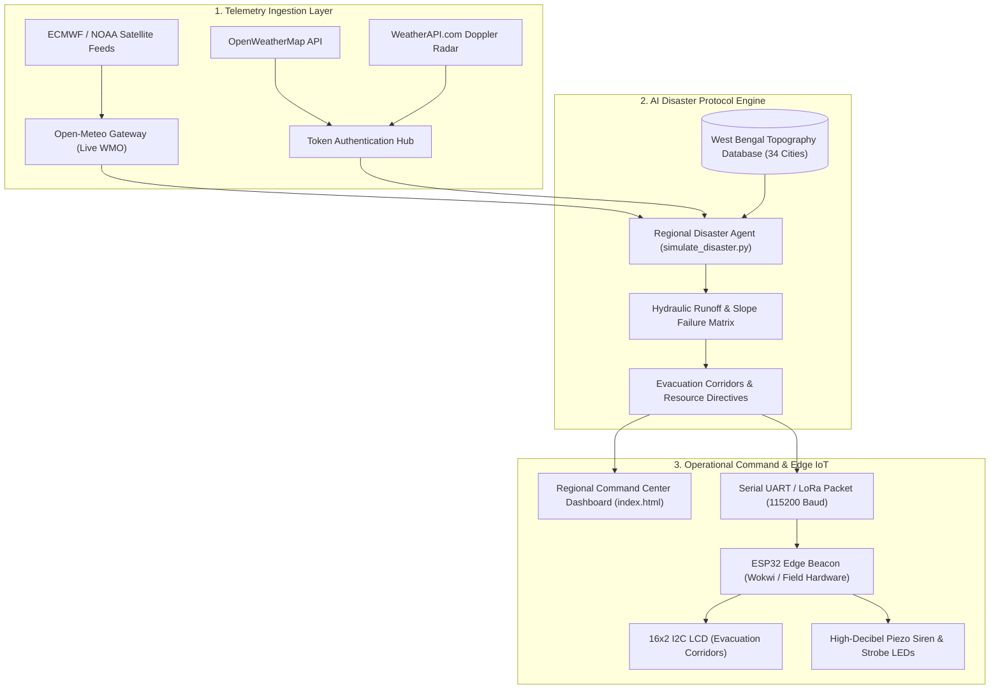

# 🚨 Regional Disaster Simulation & Response Agent

[](https://sayan2b1.github.io/disaster-response-agent/)
[](https://www.python.org/)
[](https://wokwi.com)
[](https://open-meteo.com)
[](./LICENSE)

An intelligent, end-to-end **Cyber-Physical Emergency Management System** that combines real-time numerical weather prediction, hydraulic flood risk modeling, dynamic evacuation routing, and decentralized **ESP32 Edge IoT Warning Beacons**.

Built for hackathons and regional emergency command centers managing vulnerable districts across **West Bengal, India**.

---

## 🌐 Public Live Dashboard

When hosted on GitHub Pages, the live interactive command center is publicly accessible worldwide at:
👉 **[https://sayan2b1.github.io/disaster-response-agent/](https://sayan2b1.github.io/disaster-response-agent/)**

*(Or run locally in 1 second via Python or any web browser: `python -m http.server 8085`)*

---

## 🌟 Key Features

### 1. 🏙️ Statewide West Bengal Coverage (34 Municipalities across 5 Threat Zones)
- **Zone 1: Kolkata Metro Corridor** — Kolkata, Howrah, Barasat, Barrackpore, Serampore, Chinsurah.
- **Zone 2: Coastal & Sundarbans** — Digha, Haldia, Tamluk, Contai, Kakdwip, Gosaba, Canning, Diamond Harbour.
- **Zone 3: North Bengal & Sub-Himalayan Hills** — Darjeeling, Kalimpong, Kurseong, Siliguri, Jalpaiguri, Alipurduar, Cooch Behar.
- **Zone 4: Central Gangetic Riverine Basin** — Malda, Baharampur, Krishnanagar, Kalyani, Balurghat, Raiganj.
- **Zone 5: Western Rarh & Industrial Plateau** — Asansol, Durgapur, Bardhaman, Kharagpur, Medinipur, Bankura, Purulia, Suri, Bolpur.

### 2. 🛰️ Multi-Provider Live Meteorological Telemetry & Token Authentication
- **Open-Meteo (Default, Keyless Free Tier):** Live high-resolution global numerical weather prediction data from **ECMWF** (Europe) and **NOAA GFS** (USA) via 0.1° atmospheric grid downlinks.
- **OpenWeatherMap Integration:** Connect private API tokens for official surface observatories.
- **WeatherAPI.com Integration:** Real-time Doppler radar & ASOS telemetry.
- **Disaster Stress-Test Modes:** Simulate `Critical Surge`, `Monsoon Drainage`, or `Low Hazard` scenarios even during sunny days to run emergency drills.

### 3. 🗺️ Dynamic Evacuation Routing & Threat Matrix Explorer
- **Interactive Hazard Filtering:** Filter places by **Critical** (Surge & Landslides), **Moderate** (Drainage & Gales), or **Low** (Normal).
- **Evacuation Corridors:** Automatically identifies blocked arterial roads and computes clear alternate bypass highways.
- **Resource Allocation:** Generates required counts of rescue boats, sandbag units, and medical kits calibrated to topography (coastal, riverine, hilly, urban).

### 4. ⚡ Cyber-Physical Edge IoT Warning Beacons (ESP32 + 16x2 I2C LCD)
- **Decentralized Field Alert Nodes:** Modeled after solar-powered flood warning beacons stationed at river embankments, coastal sluice gates, and cyclone shelters.
- **In-Browser Hardware Simulator:** Embedded directly in the web dashboard with animated phosphor LCD, pulsing strobe LEDs, live 115200 baud UART terminal, and Web Audio piezo siren sound.
- **Wokwi Cloud Simulator Integration:** Ready-to-copy [`sketch.ino`](./hardware/wokwi/sketch.ino) and [`diagram.json`](./hardware/wokwi/diagram.json) for testing hardware circuits on [Wokwi.com](https://wokwi.com).

---

## 🏛️ System Architecture



---

## 📂 Repository Structure

```text
disaster-response-agent/
├── index.html                  # Unified Command Center Dashboard & Virtual Hardware UI
├── requirements.txt            # Python dependencies (requests)
├── LICENSE                     # MIT Open Source License
├── README.md                   # Project documentation & presentation guide
├── SKILL.md                    # Antigravity agentic skill specification
├── scripts/
│   └── simulate_disaster.py    # Python disaster simulation CLI engine & JSON generator
└── hardware/
    └── wokwi/
        ├── sketch.ino          # ESP32 C++ firmware for 16x2 I2C LCD & siren buzzer
        ├── diagram.json        # Wokwi circuit schematic (ESP32, LCD, LEDs, Buzzer)
        ├── libraries.txt       # LiquidCrystal I2C dependency
        └── README.md           # Step-by-step Wokwi simulation guide
```

---

## 🚀 Quickstart Guide

### Option 1: Run the Web Dashboard Locally
No build tools required! The entire frontend runs in vanilla HTML5, TailwindCSS, and JavaScript:

```bash
# Clone the repository
git clone https://github.com/sayan2b1/disaster-response-agent.git
cd disaster-response-agent

# Start a lightweight local HTTP server
python -m http.server 8085
```
Open **`http://localhost:8085`** in your browser.

---

### Option 2: Run the Python Simulation Backend CLI

```bash
# Install dependencies
pip install -r requirements.txt

# Run simulation for any municipality
python scripts/simulate_disaster.py --region "tamluk"

# Run with a specific scenario (critical, moderate, low, live)
python scripts/simulate_disaster.py --region "digha" --scenario "critical"

# View statewide hazard matrix across all 34 West Bengal cities
python scripts/simulate_disaster.py --overview

# Filter places by threat level
python scripts/simulate_disaster.py --threat "critical"

# Run with an authenticated weather provider
python scripts/simulate_disaster.py --region "kolkata" --provider "openweathermap" --api-key "YOUR_API_KEY"
```

---

### Option 3: Run the Hardware Simulation in Wokwi (ESP32 + LCD)

1. Open [wokwi.com/projects/new/esp32](https://wokwi.com/projects/new/esp32).
2. Paste [`hardware/wokwi/sketch.ino`](./hardware/wokwi/sketch.ino) into the **`sketch.ino`** tab.
3. Paste [`hardware/wokwi/diagram.json`](./hardware/wokwi/diagram.json) into the **`diagram.json`** tab.
4. Ensure `LiquidCrystal I2C` is listed in **`libraries.txt`**.
5. Click **Play (▶️)**.
6. In the Wokwi Serial Monitor, test directives:
   ```text
   ALERT:KOLKATA:CRITICAL:ROUTE 1 CLEAR
   ALERT:DIGHA:CRITICAL:INLAND HIGHWAY
   ALERT:KALYANI:LOW:ALL ROADS OPEN
   ```

---

## 🌍 How to Publish and Host on GitHub Pages (Free in 60 Seconds)

1. **Commit and Push your changes to GitHub:**
   ```bash
   git add .
   git commit -m "feat: complete disaster simulation command center with edge IoT simulation"
   git push origin main
   ```

2. **Enable GitHub Pages:**
   - Go to your repository on GitHub: `https://github.com/sayan2b1/disaster-response-agent`.
   - Click **Settings** $\rightarrow$ **Pages** (in the left sidebar).
   - Under **Build and deployment** $\rightarrow$ **Source**, select **Deploy from a branch**.
   - Under **Branch**, select **`main`** and folder **`/ (root)`**.
   - Click **Save**.

3. **Your public URL is live:**
   Within 1 minute, GitHub Pages will deploy your site at:
   **`https://sayan2b1.github.io/disaster-response-agent/`**

---

## 🛡️ License

This project is licensed under the MIT License - see the [LICENSE](./LICENSE) file for details.
